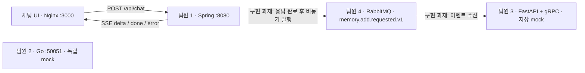

# GDGoC AI · AI Agent Chatbot 팀 프로젝트

각자 하나의 마이크로서비스를 확장해 하나의 AI agent chatbot을 만드는 실습용 보일러플레이트입니다. 프론트엔드는 완성된 상태로 제공하며, 답변 생성과 RAG API는 단순 mock입니다. 완성된 프론트엔드는 Spring mock에 연결되고, RabbitMQ 브로커와 큐, 이벤트 계약만 준비되어 있습니다. 이벤트 발행·수신은 팀원 4가, Go gateway 연결은 팀원 1·2가, 실제 메모리 저장은 팀원 3이 구현합니다.



## 실행

Docker와 Docker Compose v2를 준비한 뒤 실행하세요. 각 Dockerfile의 build context는 `team-project`입니다.

```sh
cd team-project
# 선택: 포트를 바꾸려면 .env.example을 .env로 복사하고 수정
test -f .env || cp .env.example .env
docker compose up --build -d
docker compose ps
```

- 채팅 UI: http://localhost:3000
- Spring 상태: http://localhost:8080/actuator/health
- RAG API 문서: http://localhost:8001/docs
- RAG 상태: http://localhost:8001/health
- RabbitMQ 관리 UI: http://localhost:15672

처음에는 Java/Go/Python 의존성과 이미지를 다운로드하므로 시간이 걸립니다. RabbitMQ가 준비되면 `rabbitmq-init`이 exchange·큐·binding을 생성합니다. Spring과 RAG는 RabbitMQ에 대한 시작 의존성 없이 각각 실행됩니다. 프론트엔드는 Spring의 healthcheck를 기다립니다. Go gateway는 독립적으로 시작합니다. RAG의 외부 HTTP 포트는 다른 개발 서버와의 충돌을 줄이도록 8001이며 컨테이너 내부에서는 8000을 사용합니다. 호스트 포트를 바꿔도 컨테이너 내부 주소는 그대로입니다.

```sh
docker compose logs -f
docker compose up --build -d backend       # 특정 서비스 수정 후 재빌드
docker compose restart frontend           # Spring 재생성 후 Nginx 내부 주소 갱신
docker compose down                      # 종료 및 컨테이너 제거
```

## 현재 동작

- **Spring**: UI 요청을 받아 SSE `delta`에 `안녕하세요`를 한 번 보내고 `done`으로 종료합니다. Go gateway를 호출하지 않습니다. 이벤트 발행은 아직 하지 않습니다.
- **Go gateway**: gRPC `Generate` 요청에 `안녕하세요` 청크와 `done`만 반환합니다. provider나 RAG를 호출하지 않습니다.
- **RAG**: HTTP 및 gRPC 조회는 `chunks`에 `유저는 현재 연세대학교에 재학중이다.`라는 고정 샘플 메모리 하나를 반환합니다 (`id=sample-memory-1`, `score=1.0`). HTTP 저장은 JSON `null`, gRPC 저장은 `stored=false`를 반환합니다. 실제 저장은 하지 않습니다. RabbitMQ consumer는 TODO만 있으며 자동 실행되지 않습니다.

Spring과 RAG는 서로 직접 호출하지 않습니다. RabbitMQ 인프라는 Compose에 포함되지만 producer/consumer 연결 코드는 비어 있습니다. 프론트엔드의 스트리밍 처리 기능은 준비되어 있지만 현재 mock은 고정 답변 전체를 즉시 반환합니다. 메모리 스토어, 임베딩, 검색, provider, tool 실행 및 gRPC 서비스 간 연결은 팀원이 구현할 부분입니다.

## 역할과 구현 위치

| 담당 | 폴더 / 시작점 | 확장할 내용 |
| --- | --- | --- |
| 제공 | `frontend/` | 의존성 없는 HTML/CSS/JS 채팅 UI. SSE, 대화 전환/삭제, localStorage 저장, 응답 중지, 복사, 코드 블록, 모바일 대응 |
| 팀원 1 | `backend/src/main/java/com/example/chat/ChatController.java` | gateway gRPC 연결, SSE 응답, 인증 및 대화 관리 |
| 팀원 2 | `llm-gateway/main.go` | provider 및 RAG 연결, 실제 답변 스트리밍, 컨텍스트 조합, tool 실행 루프 |
| 팀원 3 | `rag-service/main.py` | `Retrieve` 검색, `StoreMemory` 및 `handle_memory()`의 메모리 분할·임베딩·저장, 대화별 메모리 격리 |
| 팀원 4 | `MemoryEventPublisher.java`, `memory_consumer.py`, `rabbitmq/definitions.json` | RabbitMQ 설정, 응답 완료 후 비동기 이벤트 발행, 수신기 시작·종료, 수신 확인·재시도, 팀원 3의 저장 함수 연결 |
| 공동 | `proto/chat.proto` | gRPC 통신 계약. 변경 전에 서로 합의하고 관련 서비스 재빌드 |
| 팀원 4 | `MemoryRequestedEvent.java`, `memory_consumer.py` | Java와 Python 이벤트 자료형을 맞추고 팀원 1·3과 메시지 형식 합의 |

UI에는 mock 모드가 표시됩니다. 실제 provider를 연결한 뒤 `frontend/index.html`의 mock 안내를 바꾸세요. 답변은 안전한 텍스트와 fenced code block으로 표시하며 임의 HTML을 실행하지 않습니다. 대화는 현재 브라우저에 저장됩니다. 전체 대화가 서버에 영구 보관되는 구조는 아닙니다. 한 요청은 최대 100개 메시지, 메시지당 16,000자이며 한도를 넘기면 새 대화를 시작합니다.

## HTTP / SSE 계약

브라우저는 `fetch`의 streaming response를 사용합니다. POST 본문이 필요하므로 `EventSource`를 사용하지 않습니다. Nginx에서 SSE buffering을 끄고 같은 origin으로 `/api/`를 프록시합니다.

```sh
curl -N http://localhost:3000/api/chat \
  -H 'Content-Type: application/json' \
  -d '{"conversationId":"demo-1","messages":[{"role":"user","content":"안녕!"}]}'
```

```text
event: delta
data: {"content":"안녕하세요"}

event: done
data: {"conversationId":"demo-1"}
```

- `messages`: 시간순 `user` / `assistant` 목록. 실제 gateway를 연결할 때 마지막 메시지가 `user`인지 확인하는 등의 검증을 추가할 수 있습니다.
- `delta`: 답변에 덧붙일 텍스트. `done`: mock 응답 전송이 완료됨.
- `error`: `{"message":"..."}`. 스트림이 열린 뒤 발생한 오류는 이 이벤트로 표시합니다.
- 잘못된 HTTP 입력은 400입니다. 현재 mock은 동기 하위 서비스 호출이나 스트림 오류 이벤트를 생성하지 않습니다. RabbitMQ 발행 및 실패 처리는 구현 과제입니다.
- UI는 중지 버튼으로 fetch를 취소합니다. 현재 mock은 즉시 종료됩니다. 실제 스트리밍을 연결할 때 서버 측 취소 전파와 timeout도 구현하세요.

## RabbitMQ 메모리 추가 보일러플레이트

목표 흐름은 **Spring SSE 응답 완료 → RabbitMQ 발행 → RAG consumer → 메모리 저장**입니다. 현재는 인프라와 이벤트 자료형만 제공하며 실제 이벤트는 발행·수신하지 않습니다.

- 브로커: RabbitMQ 4.1.0, 관리 UI 포함.
- vhost: `/`
- exchange: `memory` (direct, durable)
- queue: `memory.add.requested.v1` (durable)
- routing key: `memory.add.requested`
- 이벤트 본문: UTF-8 JSON. `MemoryRequestedEvent.java`와 `memory_consumer.py`의 이벤트 자료형을 동일하게 유지하세요.

`rabbitmq-init`이 `rabbitmq/definitions.json`을 Management HTTP API로 가져와 exchange·큐·binding을 생성합니다. Spring과 RAG의 발행·수신 코드는 TODO 상태이며, 브로커 없이도 기존 mock API를 사용할 수 있습니다. Spring의 RabbitMQ healthcheck도 구현 전에는 비활성화되어 있습니다.

```json
{
  "schemaVersion": 1,
  "type": "memory.add.requested",
  "eventId": "a369a08d-3f85-4ee0-b35b-15b2facd581e",
  "occurredAt": "2026-11-08T13:00:00Z",
  "conversationId": "demo-1",
  "userMessage": "안녕!",
  "assistantMessage": "안녕하세요"
}
```

**팀원 4 구현 과제: 이벤트 발행**

- `ChatController.java`: 정상 응답 완료 후 이벤트 생성 및 비동기 발행 연결.
- `MemoryEventPublisher.java`: 비어 있는 `publish()`에 `RabbitTemplate` 발행 구현.
- `MemoryRequestedEvent.java`를 JSON으로 직렬화하도록 message converter 또는 직접 JSON 변환 구현.
- 사용자 응답이 브로커 확인이나 RAG 처리를 기다리지 않도록 구성하고, 발행 실패 처리 구현.

**팀원 4 구현 과제: 이벤트 수신**

- `memory_consumer.py`: 비어 있는 `consume_memory()`에 aio-pika 연결·큐 구독·JSON 역직렬화 구현.
- 수신한 이벤트를 팀원 3이 구현하는 `handle_memory()`에 전달.
- FastAPI `main.py`의 lifespan에 consumer 시작/종료 연결.
- 저장 성공 후 ACK, 실패 시 NACK/재시도 및 잘못된 이벤트 처리 정책 구현.

**팀원 3과 협업할 부분**

- 팀원 3은 `handle_memory()`에 이벤트 식별자 중복 처리와 실제 메모리 저장을 구현합니다.
- 팀원 4는 저장 성공·실패에 따라 메시지 수신 확인·거부와 재시도를 처리합니다.

Spring AMQP와 aio-pika 의존성, 연결 설정, JSON 이벤트 자료형은 준비되어 있습니다. RabbitMQ 관련 설정과 발행·수신은 팀원 4가, 실제 저장은 팀원 3이 구현합니다.

```sh
# 인프라만 실행
docker compose up -d rabbitmq rabbitmq-init

# 큐와 메시지 수 확인
docker compose exec rabbitmq rabbitmqctl list_queues name messages consumers

# exchange와 binding 확인
docker compose exec rabbitmq rabbitmqctl list_bindings
```

관리 UI: http://localhost:15672 · 기본 실습 계정: `gdgoc` / `gdgoc-dev-password`. `.env`의 `RABBITMQ_USERNAME`, `RABBITMQ_PASSWORD`로 초기 계정을 바꿀 수 있습니다. 이미 생성된 브로커 계정은 환경 변수 변경만으로 갱신되지 않습니다.

컨테이너에서의 연결 주소는 `rabbitmq:5672`, 호스트에서는 `localhost:5672`입니다. Python에서 사용할 `RABBITMQ_HOST`, `RABBITMQ_PORT`, `RABBITMQ_USERNAME`, `RABBITMQ_PASSWORD`는 Compose가 전달합니다. 호스트에서 실행할 때는 해당 환경 변수를 설정하세요. 기본 vhost `/`와 위 큐 이름을 사용합니다.

`.env`의 `RABBITMQ_PORT`, `RABBITMQ_MANAGEMENT_PORT`로 외부 포트를 바꿀 수 있습니다. 큐 이름·exchange·routing key를 바꾸려면 `rabbitmq/definitions.json`과 Spring `application.yml`의 `app.memory` 설정을 함께 수정하세요. 브로커 데이터는 `rabbitmq-data` 볼륨에 유지됩니다. 메시지를 재시작 후에도 보존하려면 발행 시 persistent 메시지 설정도 구현하세요.

## proto 생성과 로컬 개발

생성 코드는 직접 수정하거나 커밋하지 않습니다. Docker 빌드 중 언어별로 `proto/chat.proto`에서 생성합니다.

- Java 21 / Maven: protobuf Maven plugin이 `target/generated-sources`로 생성합니다. 현재 Spring mock은 생성된 클라이언트를 사용하지 않습니다.
- Go 1.23: `protoc-gen-go`와 `protoc-gen-go-grpc`가 `llm-gateway/gen`으로 생성합니다.
- Python 3.12: `grpcio-tools`가 Python 모듈을 생성합니다. FastAPI lifespan에서 비동기 gRPC 서버도 시작합니다. Uvicorn은 **단일 worker**로 실행해야 gRPC 포트가 충돌하지 않습니다.

호스트에서 개별 개발할 때의 예시입니다. Java/Go/Python과 언어별 빌드 도구가 필요합니다. 의존성 버전은 각 빌드 파일에 명시되어 있습니다.

```sh
# Spring (독립 실행 가능)
cd backend
mvn spring-boot:run

# Go (독립 실행 가능)
cd llm-gateway
go install google.golang.org/protobuf/cmd/protoc-gen-go@v1.36.5
go install google.golang.org/grpc/cmd/protoc-gen-go-grpc@v1.5.1
export PATH="$(go env GOPATH)/bin:$PATH"
mkdir -p gen
protoc -I ../proto --go_out=gen --go_opt=paths=source_relative \
  --go-grpc_out=gen --go-grpc_opt=paths=source_relative ../proto/chat.proto
go mod tidy
go run .

# Python
cd rag-service
python3 -m venv .venv
. .venv/bin/activate
pip install -r requirements.txt
python -m grpc_tools.protoc -I ../proto --python_out=. --grpc_python_out=. ../proto/chat.proto
uvicorn main:app --host 0.0.0.0 --port 8000 --reload
```

위 블록의 각 서비스 명령은 `team-project`를 기준으로 **서로 다른 터미널**에서 실행하세요. 프론트엔드는 Compose의 Nginx로 제공됩니다. 프론트만 정적 서버로 열 경우 `/api/` 프록시도 구성해야 합니다.

참고: [gRPC Go 스트리밍](https://grpc.io/docs/languages/go/basics/), [gRPC Python 코드 생성](https://grpc.io/docs/languages/python/quickstart/), [Spring SSE](https://docs.spring.io/spring-framework/reference/web/webmvc/mvc-ann-async.html).

RabbitMQ 참고: [Spring AMQP](https://docs.spring.io/spring-boot/reference/messaging/amqp.html), [RabbitMQ 작업 큐](https://www.rabbitmq.com/tutorials/tutorial-two-python), [aio-pika](https://docs.aio-pika.com/quick-start.html).
