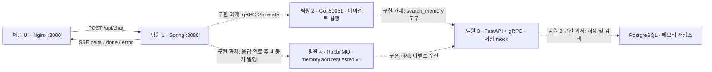

# GDGoC AI · AI Agent Chatbot 팀 프로젝트

각자 하나의 마이크로서비스를 확장해 하나의 AI agent chatbot을 만드는 실습용 보일러플레이트입니다. 프론트엔드는 완성된 상태로 제공하며, 답변 생성과 RAG API는 단순 mock입니다. 완성된 프론트엔드는 Spring mock에 연결되고, RabbitMQ 브로커와 큐, 이벤트 계약만 준비되어 있습니다. 이벤트 발행·수신은 팀원 4가, Go gateway 연결은 팀원 1·2가, PostgreSQL을 이용한 실제 메모리 저장은 팀원 3이 구현합니다.



## 실행

Docker와 Docker Compose v2를 준비한 뒤 실행하세요. 각 Dockerfile의 build context는 `team-project`입니다.

```sh
cd team-project
# 선택: 포트를 바꾸려면 .env.example을 .env로 복사하고 수정
test -f .env || cp .env.example .env
docker compose up --build -d
docker compose ps
```

- 채팅 UI: http://localhost:3000
- Spring 상태: http://localhost:8080/actuator/health
- RAG API 문서: http://localhost:8001/docs
- RAG 상태: http://localhost:8001/health
- RabbitMQ 관리 UI: http://localhost:15672
- PostgreSQL: `localhost:15432` (기본 데이터베이스 `chatbot`)

처음에는 Java/Go/Python 의존성과 이미지를 다운로드하므로 시간이 걸립니다. RabbitMQ가 준비되면 `rabbitmq-init`이 exchange·큐·binding을 생성합니다. Spring과 RAG는 RabbitMQ에 대한 시작 의존성 없이 각각 실행됩니다. 프론트엔드는 Spring의 healthcheck를 기다립니다. Go gateway는 독립적으로 시작합니다. RAG의 외부 HTTP 포트는 다른 개발 서버와의 충돌을 줄이도록 8001이며 컨테이너 내부에서는 8000을 사용합니다. 호스트 포트를 바꿔도 컨테이너 내부 주소는 그대로입니다.

```sh
docker compose logs -f
docker compose up --build -d backend       # 특정 서비스 수정 후 재빌드
docker compose restart frontend           # Spring 재생성 후 Nginx 내부 주소 갱신
docker compose down                      # 종료 및 컨테이너 제거
```

## 현재 동작

- **Spring**: UI 요청을 받아 SSE `delta`에 `안녕하세요`를 한 번 보내고 `done`으로 종료합니다. Go gateway를 호출하지 않습니다. 이벤트 발행은 아직 하지 않습니다.
- **Go gateway**: gRPC `Generate` 요청에 `안녕하세요` 청크와 `done`만 반환합니다. provider나 RAG를 호출하지 않습니다.
- **RAG**: HTTP 및 gRPC 조회는 `chunks`에 `유저는 현재 연세대학교에 재학중이다.`라는 고정 샘플 메모리 하나를 반환합니다 (`id=sample-memory-1`, `score=1.0`). HTTP 저장은 JSON `null`, gRPC 저장은 `stored=false`를 반환합니다. 실제 저장은 하지 않습니다. RabbitMQ consumer는 TODO만 있으며 자동 실행되지 않습니다.

Spring과 RAG는 서로 직접 호출하지 않습니다. RabbitMQ 인프라는 Compose에 포함되지만 producer/consumer 연결 코드는 비어 있습니다. 프론트엔드의 스트리밍 처리 기능은 준비되어 있지만 현재 mock은 고정 답변 전체를 즉시 반환합니다. 메모리 스토어, 임베딩, 검색, provider, tool 실행 및 gRPC 서비스 간 연결은 팀원이 구현할 부분입니다.

## 역할과 구현 위치

| 담당 | 폴더 / 시작점 | 확장할 내용 |
| --- | --- | --- |
| 제공 | `frontend/` | 의존성 없는 HTML/CSS/JS 채팅 UI. SSE, 대화 목록·생성·조회·삭제 API 연동, 응답 중지, 복사, 코드 블록, 모바일 대응 |
| 팀원 1 | `backend/src/main/java/com/example/chat/ChatController.java` | gateway gRPC 연결, SSE 응답 및 인증 |
| 팀원 2 | `llm-gateway/main.go` | 모델 연동, `get_current_time`·`search_memory` 도구, 도구 실행 반복 흐름, 최종 답변 스트리밍 |
| 팀원 3 | `rag-service/main.py` | `Retrieve` 검색, `StoreMemory` 및 `handle_memory()`의 메모리 분할·임베딩·저장, 대화별 메모리 격리 |
| 팀원 4 | `MemoryEventPublisher.java`, `memory_consumer.py`, `rabbitmq/definitions.json` | RabbitMQ 설정, 응답 완료 후 비동기 이벤트 발행, 수신기 시작·종료, 수신 확인·재시도, 팀원 3의 저장 함수 연결 |
| 팀원 5 | `ConversationController.java`, `ChatController.java`, `postgres/init.sql` | 채팅 내역 API의 DB 구현, 메시지 저장, 채팅 내역 테이블 설계 |
| 팀원 3 | `postgres/init.sql` | PostgreSQL 테이블 설계, 이벤트 중복 처리, 메모리 저장·검색 |
| 공동 | `proto/chat.proto` | gRPC 통신 계약. 변경 전에 서로 합의하고 관련 서비스 재빌드 |
| 팀원 4 | `MemoryRequestedEvent.java`, `memory_consumer.py` | Java와 Python 이벤트 자료형을 맞추고 팀원 1·3과 메시지 형식 합의 |

UI에는 mock 모드가 표시됩니다. 실제 provider를 연결한 뒤 `frontend/index.html`의 mock 안내를 바꾸세요. 답변은 안전한 텍스트와 fenced code block으로 표시하며 임의 HTML을 실행하지 않습니다. 프론트는 채팅 내역을 API로 조회하며 브라우저 저장소를 사용하지 않습니다. 현재 백엔드는 저장하지 않는 mock이므로 새로고침하면 대화가 사라집니다. 한 요청은 최대 100개 메시지, 메시지당 16,000자이며 한도를 넘기면 새 대화를 시작합니다.

## 팀원 2: LLM gateway와 도구 실행

Go gateway는 모델 호출, 도구 실행, 도구 결과를 이용한 후속 모델 호출, 최종 답변 스트리밍을 담당합니다. 실습 도구는 `get_current_time`과 `search_memory` 두 가지입니다. 현재 코드는 `안녕하세요`만 반환하는 mock이며 아래 내용은 팀원 2가 구현할 명세입니다.

### 도구: `get_current_time`

- 목적: 현재 날짜·시각이 필요한 질문에 서버에서 확인한 시간을 제공합니다.
- 입력: `{}`. 시간대는 `Asia/Seoul`로 고정합니다.
- 실행: Go에서 현재 시각을 읽고 지정한 시간대로 변환합니다. 다른 서비스는 호출하지 않습니다.
- 출력: `datetime`은 시차를 포함한 RFC 3339 문자열, `timezone`은 시간대 이름입니다.

```json
{
  "datetime": "2026-11-18T16:00:00+09:00",
  "timezone": "Asia/Seoul"
}
```

위 시각은 출력 형식 예시이며, 실제 실행할 때마다 현재 시각을 반환해야 합니다. 예시 질문은 “지금 한국 시간으로 몇 시야?”입니다.

### 도구: `search_memory`

- 목적: 사용자의 이전 정보나 기억이 필요한 질문에서 관련 메모리를 검색합니다.
- 입력: 내용이 있는 문자열 `query`.
- 실행: gRPC `RagService.Retrieve`를 호출합니다. `query`는 도구 입력에서, `conversation_id`는 Spring이 전달한 `ChatRequest.conversation_id`에서 가져옵니다. 대화 식별자는 모델이 임의로 지정하는 도구 인자에 포함하지 않습니다.
- 출력: `{"chunks":[...]}` 형태의 객체. 각 항목은 `id`, `content`, `score`를 가집니다. 검색 결과가 없으면 `{"chunks":[]}`를 반환합니다.

입력 예시:

```json
{
  "query": "사용자가 재학 중인 학교"
}
```

현재 RAG mock을 연결했을 때의 출력 예시:

```json
{
  "chunks": [
    {
      "id": "sample-memory-1",
      "content": "유저는 현재 연세대학교에 재학중이다.",
      "score": 1.0
    }
  ]
}
```

예시 질문은 “내가 어느 학교 다닌다고 했지?”입니다. 실제 메모리 검색과 저장 구현은 팀원 3이 담당하고, gateway는 도구 호출과 결과 전달을 담당합니다.

### 실행 흐름과 완료 조건

1. Spring의 gRPC `Generate` 요청에서 대화 식별자와 메시지 이력을 받습니다.
2. 모델에 대화 이력과 두 도구의 이름·설명·입력 인자 정의를 함께 전달합니다.
3. 모델이 도구를 요청하면 이름과 인자를 검증하고 해당 도구를 실행합니다. 한 응답에서 여러 도구를 요청하면 각각 실행 결과를 준비합니다.
4. 모델이 제공한 도구 호출 식별자에 맞춰 결과를 돌려주고 모델을 다시 호출합니다. 도구 요청이 계속되면 이 과정을 반복하되 최대 5회로 제한합니다.
5. 최종 사용자 답변을 기존 `ChatChunk.delta`로 스트리밍하고, 완료 시 `done=true`를 한 번 보냅니다. 도구 호출 인자와 결과는 사용자 답변에 그대로 노출하지 않습니다.

도구 오류는 모델이 이해할 수 있는 오류 결과로 전달하고, 실행 시간 제한과 요청 취소를 처리하세요. RAG 호출 실패를 검색 결과 없음으로 바꾸지 말고 구분하세요. 현재 `proto/chat.proto`의 `Generate`와 `Retrieve` 계약을 사용하며 도구 실행 과정은 gateway 내부에서 처리합니다.

## 팀원 5: DB 기반 채팅 내역

프론트의 채팅 내역 API 호출은 구현되어 있습니다. 초기 목록 조회, 대화 생성, 대화 선택 시 메시지 조회, 삭제를 서버에 요청합니다. 브라우저 저장소는 사용하지 않습니다. 목록 로딩·조회 실패 재시도·생성/삭제 실패·응답 중지도 처리합니다.

| 동작 | API | 요청 / 응답 |
| --- | --- | --- |
| 목록 조회 | `GET /api/conversations` | 대화 배열. 각 항목은 `id`, `title`, `createdAt`, `updatedAt` |
| 첫 메시지 전 대화 생성 | `POST /api/conversations` | 요청 `{"title":"첫 질문"}`, 응답 201 및 생성된 대화 객체 |
| 대화 선택 | `GET /api/conversations/{id}/messages` | 시간순 메시지 배열. 각 항목은 `id`, `role`, `content`, `status`, `createdAt` |
| 대화 삭제 | `DELETE /api/conversations/{id}` | 성공 응답 204 |
| 사용자 메시지와 답변 저장 | `POST /api/chat` | 생성된 `conversationId`와 대화 이력 전달. 백엔드가 이번 사용자 메시지와 생성한 답변을 저장 |

현재 `ConversationController.java`는 **DB를 사용하지 않는 mock**입니다. 목록과 메시지 조회는 빈 배열, 생성은 임시 식별자가 담긴 객체, 삭제는 204를 반환합니다. 따라서 프론트에서 새 대화를 진행할 수 있지만 새로고침 또는 메시지 재조회 시 내역은 복원되지 않습니다. 실제 저장과 복원은 팀원 5가 구현합니다.

팀원 5가 구현할 내용:

- 대화 및 원문 메시지를 저장할 테이블 설계. 팀원 3의 검색용 메모리 테이블과 구분합니다.
- `ConversationController.java`의 목록·생성·메시지 조회·삭제를 DB에 연결.
- 목록은 최근 갱신 순, 메시지는 대화 내 시간순으로 반환. 없는 대화는 404 처리.
- `ChatController.java`에서 이번 사용자 메시지와 완성된 답변 저장 및 최근 갱신 시각 반영.
- 요청에 전체 이력이 포함되므로 과거 메시지의 중복 저장 방지. 프론트는 별도 메시지 저장 API를 중복 호출하지 않습니다.
- 실패·중단 응답의 저장 정책과 메시지 식별자를 설계. `status`는 `done`, `stopped`, `error` 중 하나로 반환합니다.

프론트와 백엔드의 API 경로·필드 계약을 유지하면 프론트 수정 없이 DB 구현을 연결할 수 있습니다.

## HTTP / SSE 계약

브라우저는 `fetch`의 streaming response를 사용합니다. POST 본문이 필요하므로 `EventSource`를 사용하지 않습니다. Nginx에서 SSE buffering을 끄고 같은 origin으로 `/api/`를 프록시합니다.

```sh
curl -N http://localhost:3000/api/chat \
  -H 'Content-Type: application/json' \
  -d '{"conversationId":"demo-1","messages":[{"role":"user","content":"안녕!"}]}'
```

```text
event: delta
data: {"content":"안녕하세요"}

event: done
data: {"conversationId":"demo-1"}
```

- `messages`: 시간순 `user` / `assistant` 목록. 실제 gateway를 연결할 때 마지막 메시지가 `user`인지 확인하는 등의 검증을 추가할 수 있습니다.
- `delta`: 답변에 덧붙일 텍스트. `done`: mock 응답 전송이 완료됨.
- `error`: `{"message":"..."}`. 스트림이 열린 뒤 발생한 오류는 이 이벤트로 표시합니다.
- 잘못된 HTTP 입력은 400입니다. 현재 mock은 동기 하위 서비스 호출이나 스트림 오류 이벤트를 생성하지 않습니다. RabbitMQ 발행 및 실패 처리는 구현 과제입니다.
- UI는 중지 버튼으로 fetch를 취소합니다. 현재 mock은 즉시 종료됩니다. 실제 스트리밍을 연결할 때 서버 측 취소 전파와 timeout도 구현하세요.

## RabbitMQ 메모리 추가 보일러플레이트

목표 흐름은 **Spring SSE 응답 완료 → RabbitMQ 발행 → RAG consumer → 메모리 저장**입니다. 현재는 인프라와 이벤트 자료형만 제공하며 실제 이벤트는 발행·수신하지 않습니다.

- 브로커: RabbitMQ 4.1.0, 관리 UI 포함.
- vhost: `/`
- exchange: `memory` (direct, durable)
- queue: `memory.add.requested.v1` (durable)
- routing key: `memory.add.requested`
- 이벤트 본문: UTF-8 JSON. `MemoryRequestedEvent.java`와 `memory_consumer.py`의 이벤트 자료형을 동일하게 유지하세요.

`rabbitmq-init`이 `rabbitmq/definitions.json`을 Management HTTP API로 가져와 exchange·큐·binding을 생성합니다. Spring과 RAG의 발행·수신 코드는 TODO 상태이며, 브로커 없이도 기존 mock API를 사용할 수 있습니다. Spring의 RabbitMQ healthcheck도 구현 전에는 비활성화되어 있습니다.

```json
{
  "schemaVersion": 1,
  "type": "memory.add.requested",
  "eventId": "a369a08d-3f85-4ee0-b35b-15b2facd581e",
  "occurredAt": "2026-11-08T13:00:00Z",
  "conversationId": "demo-1",
  "userMessage": "안녕!",
  "assistantMessage": "안녕하세요"
}
```

**팀원 4 구현 과제: 이벤트 발행**

- `ChatController.java`: 정상 응답 완료 후 이벤트 생성 및 비동기 발행 연결.
- `MemoryEventPublisher.java`: 비어 있는 `publish()`에 `RabbitTemplate` 발행 구현.
- `MemoryRequestedEvent.java`를 JSON으로 직렬화하도록 message converter 또는 직접 JSON 변환 구현.
- 사용자 응답이 브로커 확인이나 RAG 처리를 기다리지 않도록 구성하고, 발행 실패 처리 구현.

**팀원 4 구현 과제: 이벤트 수신**

- `memory_consumer.py`: 비어 있는 `consume_memory()`에 aio-pika 연결·큐 구독·JSON 역직렬화 구현.
- 수신한 이벤트를 팀원 3이 구현하는 `handle_memory()`에 전달.
- FastAPI `main.py`의 lifespan에 consumer 시작/종료 연결.
- 저장 성공 후 ACK, 실패 시 NACK/재시도 및 잘못된 이벤트 처리 정책 구현.

**팀원 3과 협업할 부분**

- 팀원 3은 `handle_memory()`에 이벤트 식별자 중복 처리와 실제 메모리 저장을 구현합니다.
- 팀원 4는 저장 성공·실패에 따라 메시지 수신 확인·거부와 재시도를 처리합니다.

Spring AMQP와 aio-pika 의존성, 연결 설정, JSON 이벤트 자료형은 준비되어 있습니다. RabbitMQ 관련 설정과 발행·수신은 팀원 4가, 실제 저장은 팀원 3이 구현합니다.

```sh
# 인프라만 실행
docker compose up -d rabbitmq rabbitmq-init

# 큐와 메시지 수 확인
docker compose exec rabbitmq rabbitmqctl list_queues name messages consumers

# exchange와 binding 확인
docker compose exec rabbitmq rabbitmqctl list_bindings
```

관리 UI: http://localhost:15672 · 기본 실습 계정: `gdgoc` / `gdgoc-dev-password`. `.env`의 `RABBITMQ_USERNAME`, `RABBITMQ_PASSWORD`로 초기 계정을 바꿀 수 있습니다. 이미 생성된 브로커 계정은 환경 변수 변경만으로 갱신되지 않습니다.

컨테이너에서의 연결 주소는 `rabbitmq:5672`, 호스트에서는 `localhost:5672`입니다. Python에서 사용할 `RABBITMQ_HOST`, `RABBITMQ_PORT`, `RABBITMQ_USERNAME`, `RABBITMQ_PASSWORD`는 Compose가 전달합니다. 호스트에서 실행할 때는 해당 환경 변수를 설정하세요. 기본 vhost `/`와 위 큐 이름을 사용합니다.

`.env`의 `RABBITMQ_PORT`, `RABBITMQ_MANAGEMENT_PORT`로 외부 포트를 바꿀 수 있습니다. 큐 이름·exchange·routing key를 바꾸려면 `rabbitmq/definitions.json`과 Spring `application.yml`의 `app.memory` 설정을 함께 수정하세요. 브로커 데이터는 `rabbitmq-data` 볼륨에 유지됩니다. 메시지를 재시작 후에도 보존하려면 발행 시 persistent 메시지 설정도 구현하세요.

## PostgreSQL 메모리 저장소

Spring backend는 JDBC 데이터 소스와 PostgreSQL 드라이버로 연결 설정까지 제공합니다. Compose가 `SPRING_DATASOURCE_URL`, `SPRING_DATASOURCE_USERNAME`, `SPRING_DATASOURCE_PASSWORD`를 전달하며, PostgreSQL 준비 후 backend가 시작됩니다. 기존 `.env`의 `POSTGRES_DB`, `POSTGRES_USER`, `POSTGRES_PASSWORD`를 공유합니다.

```sh
# PostgreSQL과 backend 실행 (데이터베이스도 자동 시작)
docker compose up -d --build backend
```

backend의 채팅 내역 조회·저장과 테이블 설계는 팀원 5의 TODO입니다. 테이블 자동 생성 기능은 추가하지 않았습니다. `/actuator/health`는 데이터베이스 연결 상태를 함께 확인합니다.

PostgreSQL 17과 초기 테이블을 제공합니다. 현재 RAG API는 샘플 응답을 유지하며 데이터베이스 연결·저장·조회는 팀원 3이 구현합니다. RAG는 데이터베이스가 없어도 mock으로 실행할 수 있습니다.

- `memory_events`: 이벤트 식별자, 대화 식별자, 사용자 메시지와 답변, 발생·저장 시각.
- `memory_chunks`: 이벤트별 문서 조각과 조각 순서. 이벤트 테이블을 통해 대화별로 조회합니다.
- `event_id` 기본 키와 이벤트별 조각 순서 고유 제약을 제공합니다. 실제 중복 처리 및 트랜잭션 코드는 구현 과제입니다.
- 임베딩 저장과 벡터 검색은 팀원 3이 추가로 설계합니다.

```sh
# 데이터베이스 실행
docker compose up -d postgres

# 데이터베이스 터미널 접속
docker compose exec postgres sh -c 'exec psql -U "$POSTGRES_USER" -d "$POSTGRES_DB"'

# RAG 코드 수정 후 데이터베이스와 함께 실행
docker compose up -d --build postgres rag-service
```

접속 기본값은 데이터베이스 `chatbot`, 계정 `gdgoc` / `gdgoc-dev-password`입니다. 호스트에서는 `localhost:15432`, 컨테이너에서는 `postgres:5432`를 사용합니다. 기본 외부 포트는 로컬 PostgreSQL과의 충돌을 줄이도록 15432입니다.

`.env`의 `POSTGRES_PORT`, `POSTGRES_DB`, `POSTGRES_USER`, `POSTGRES_PASSWORD`로 초기 접속 정보를 설정합니다. RAG에는 표준 연결 환경 변수 `PGHOST`, `PGPORT`, `PGDATABASE`, `PGUSER`, `PGPASSWORD`와 Psycopg 의존성을 제공합니다. 실제 연결 수명 주기, 저장 및 조회 코드는 비워 두었습니다.

`postgres/init.sql`은 빈 데이터 볼륨의 첫 실행에만 적용됩니다. 기존 볼륨에서 테이블을 변경할 때는 별도 변경 SQL을 적용하세요. 초기 계정과 비밀번호도 이미 초기화된 데이터베이스에서는 환경 변수 수정만으로 바뀌지 않습니다. 데이터는 `postgres-data` 볼륨에 유지되며 일반 `docker compose down`으로 지워지지 않습니다.

## 서비스별 개발과 proto 생성

로컬에는 Docker와 Docker Compose만 있으면 됩니다. Java·Go·Python과 proto 생성 도구는 이미지 빌드 중 설치되며, `proto/chat.proto`의 언어별 코드도 자동 생성됩니다. 생성 코드는 직접 수정하거나 커밋하지 않습니다.

`team-project` 폴더에서 담당 서비스만 지정해 실행하세요.

```sh
# 팀원 1: Spring
docker compose up --build backend

# 팀원 2: Go 게이트웨이
docker compose up --build llm-gateway

# 팀원 3: 데이터베이스와 RAG
docker compose up --build postgres rag-service

# 팀원 4: 메시지 브로커와 큐 초기화
docker compose up -d rabbitmq rabbitmq-init

# 팀원 4: 발행·수신 코드를 수정한 뒤 해당 서비스 재빌드
docker compose up --build backend rag-service

# 채팅 UI도 함께 확인 (Spring도 자동 실행)
docker compose up --build frontend backend
```

현재 소스는 이미지에 복사되므로 파일을 수정해도 실행 중인 컨테이너에 자동 반영되지 않습니다. 수정 후 같은 `up --build` 명령을 다시 실행하세요. `up`만 실행하면 기존 이미지를 사용할 수 있고, `restart`는 이미지를 다시 빌드하지 않습니다.

백그라운드 실행에는 `-d`를 붙이고, 로그는 `docker compose logs -f 서비스명`으로 확인합니다. Spring 컨테이너를 재생성한 뒤 이미 실행 중인 UI가 연결되지 않으면 `docker compose restart frontend`로 프록시 주소를 갱신하세요.

proto를 수정하면 해당 계약을 사용하는 서비스들을 함께 재빌드합니다.

```sh
docker compose up -d --build backend llm-gateway rag-service
```

Python 서비스는 HTTP와 gRPC 서버를 함께 실행하므로 다중 작업자 실행을 추가할 때 gRPC 포트가 충돌하지 않도록 구성해야 합니다.

참고: [gRPC Go 스트리밍](https://grpc.io/docs/languages/go/basics/), [gRPC Python 코드 생성](https://grpc.io/docs/languages/python/quickstart/), [Spring SSE](https://docs.spring.io/spring-framework/reference/web/webmvc/mvc-ann-async.html).

RabbitMQ 참고: [Spring AMQP](https://docs.spring.io/spring-boot/reference/messaging/amqp.html), [RabbitMQ 작업 큐](https://www.rabbitmq.com/tutorials/tutorial-two-python), [aio-pika](https://docs.aio-pika.com/quick-start.html).

PostgreSQL 참고: [공식 Docker 이미지](https://hub.docker.com/_/postgres), [Psycopg 설치](https://www.psycopg.org/psycopg3/docs/basic/install.html).
